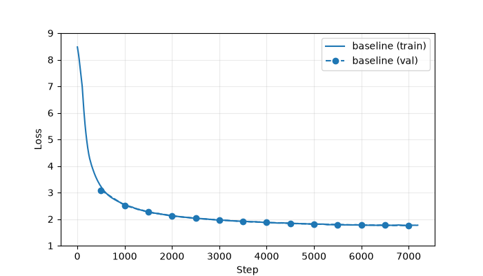
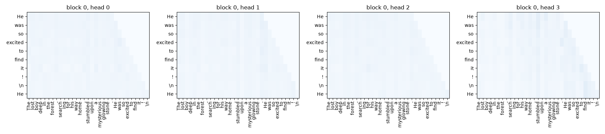
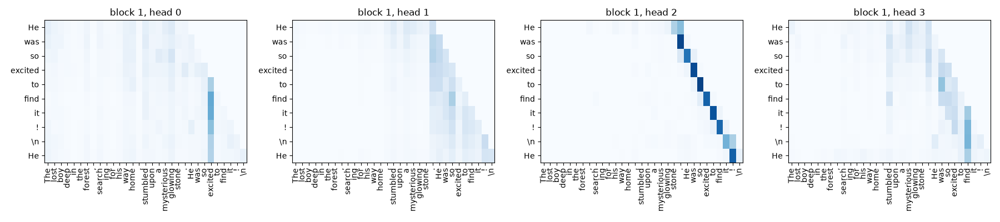
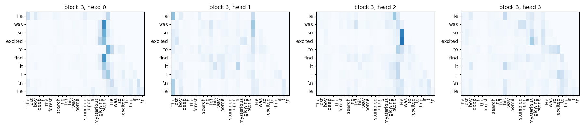

# Assignment 3 Report

Name: Hamza Amar

UCID: 30144227

Tip: To include figures in your report, put them in the `assets` folder and
link to the relative path of the images. For a Matplotlib figure, call, for
example, `plt.savefig("assets/baseline_loss.png")` before
`plt.show()`.

## AI use declaration (1 mark)

List any sources you referred to or generative-AI assistance you used, and explain how you verified the contribution. If you did not use generative AI, write: `I did not use generative AI for this assignment.`

| Source | Source contribution | How I verified it |
| ------ | ------------------- | ----------------- |
| Claude | I used it to generate pseudo code and also to tell me what functions I had available to me so that I could complete the code portions. | I verified by running the cells to check if it matchs with the expected outputs. |

## Questions

### 1. Baseline model (2 marks)

Report the validation results of the baseline model.

| Validation result | Value |
| ----------------- | ----: |
| Loss              | 1.764 |
| Perplexity        |  5.84 |

The training loss starts near 8.48 (about the same as random guessing) and
drops fast in the first few hundred steps. After that it falls more slowly and
levels off around 1.77 by the end of the one epoch. The validation loss follows
the same path, going from 3.085 to 1.764. The two curves stay close together,
so the model is not overfitting.

### 2. Sampling settings (2 marks)

Prompt: `Once upon a time` (generation seed 0).

**Temperature 0.5 (no top-k):**

> Once upon a time, there was a little boy named Tim. Tim had a big sack. He
> liked to play with his sack every day. ... "No, Tim. You can't play with your
> sack." Tim was sad. He thought of a plan. He went to the park and found a big
> sack. ... His mom smiled and said, "That's a great

**Temperature 1.0 (no top-k):**

> Once upon a time, there was a little boy named Tim. Tim had a friend named
> Max. They loved to play together. One day, Tim and Max went to the park. They
> saw a hole in the ground. ... They found the egg they found! Tim was not
> grumpy anymore. He gave the egg back to Max. ... And that is the moral of the
> story.

**Temperature 1.5 (no top-k):**

> Once upon a time, there was a charming flower in a mild bree corner of any
> longer. Two friends lived in their modern tree! ... knowing that it canoom set
> yourself available!" Two boys souvented really agreed ... sword can not attract
> sironain Mommy ple.

**Temperature 1.5, top-k 50:**

> Once upon a time, there was a little flower in a big berry bush. "Achoy," said
> Grandma. Every morning sundlings that when you are ready in home ... The war
> were made of many bunnies. Mama quickly made the hive even the ones that Mama
> stayed extra. ... Soon they would get better!

1. Temperature controls how random the next token is. A low
temperature of 0.5 makes the model pick the most likely tokens, so the story is
clear and correct but boring and repetitive (it keeps saying "sack").
Temperature of 1.0 gives more variety while staying readable. A high temperature
of 1.5 makes the model pick unlikely tokens too, so the text turns into
gibberish with made-up words like "canoom" and "souvented".

2. Top-k only lets the model choose from the "k" most likely tokens
and blocks the rest. With temperature 1.5, adding top-k=50 makes the story much
less broken: the plot is still random, but the made-up non-words mostly go away,
because the very unlikely tokens are no longer allowed.

### 3. Attention weights (2 marks)

Prompt: `The lost boy deep in the forest searching for his way home stumbled upon a mysterious glowing stone.`
The model continues (greedily) with `He was so excited to find it! \n He`.

Block 0 (first block):

Block 1:

Block 3 (last block):

Yes, the plots show clear patterns, and they get sharper in the later blocks.
In **block 0** the attention is spread out: each token looks at many earlier
tokens at once, so the first block just gathers general context.

In **block 1** some heads get more specific. Head 2 shows a clear diagonal,
meaning each token mostly looks at the one token right before it.

In **block 3** (the last block) the attention is sharp and points at important
words. Some heads focus on the key words "glowing stone" and on the new subject
"He", and others focus on the period "." and the first word "The". So the model
starts broad, then looks at the previous word, and finally focuses on the words
that actually matter.

## Reflection (1 mark)

Include a sentence or two about:

- what you liked or disliked about the course so far, and
- what you found interesting, confusing, challenging, or motivating while working on this assignment. 
- I really like how the assignment is structured, with the code-along portions accompanied by explanations and test cases to ensure everything I am doing is correct. The challenging part is knowing which tools/functions I need to use for the coding portions. I wish the examples showed some pseudocode or something to help guide us along.